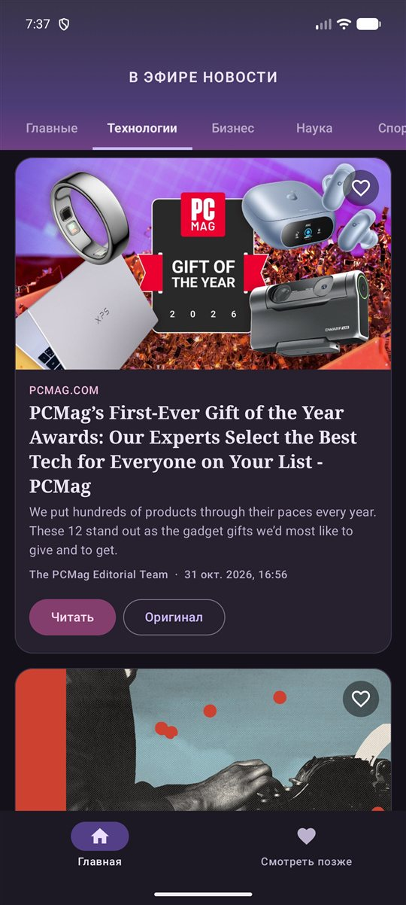
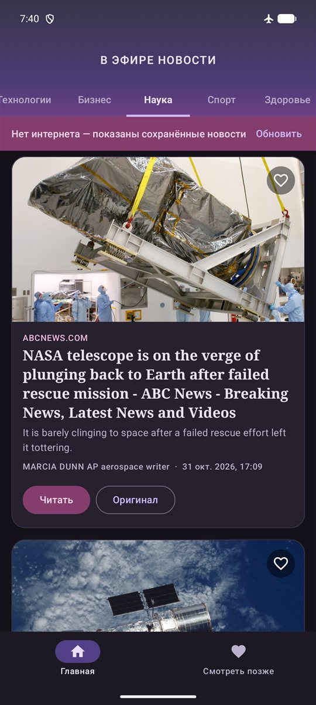
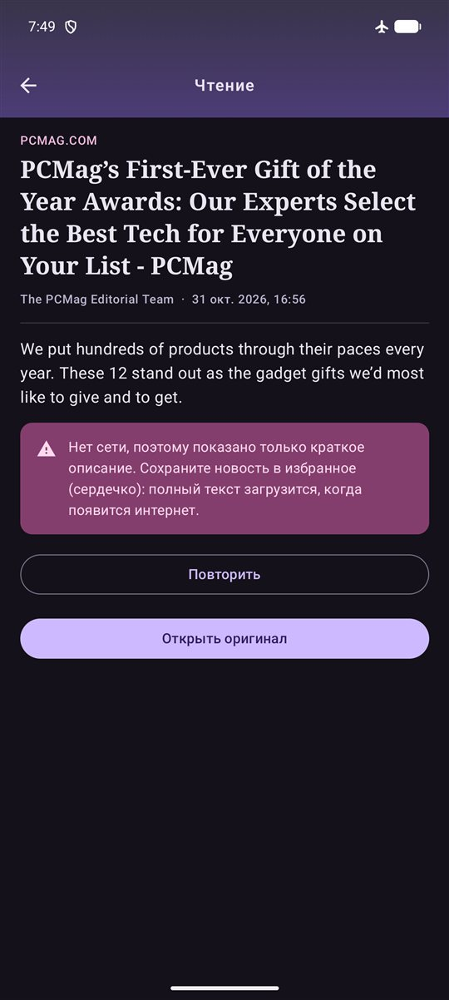
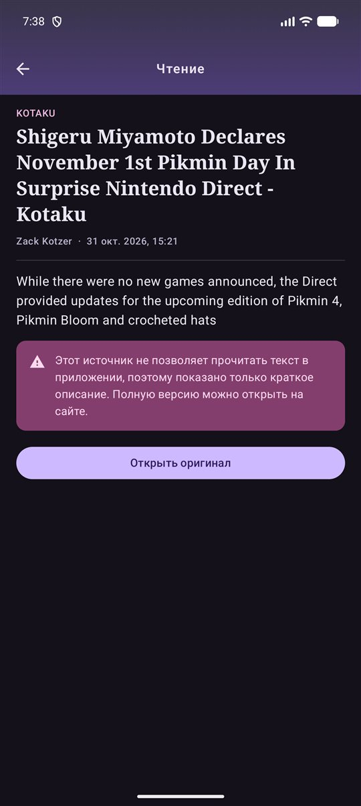
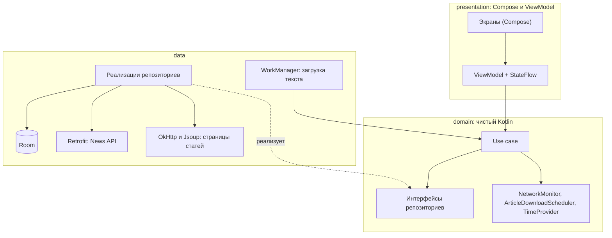
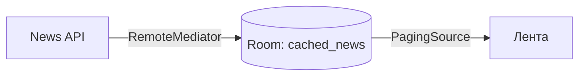

# LearningNews


Новостное приложение для Android с **офлайн-чтением**: ленту и полный текст статей можно читать без интернета.
Сделано на Kotlin и Jetpack Compose по принципам Clean Architecture и MVVM. Новости приходят из [News API](https://newsapi.org).

[Возможности](#возможности) · [Архитектура](#архитектура) · [Технологии](#технологии) · [Как запустить](#как-запустить) · [Ограничения](#ограничения) · [Планы](#планы)

## Скриншоты

<table>
  <tr>
    <td align="center"><br><sub>Лента по темам</sub></td>
    <td align="center"><br><sub>Чтение статьи</sub></td>
    <td align="center"><br><sub>Смотреть позже</sub></td>
  </tr>
  <tr>
    <td align="center"><br><sub>Лента без сети</sub></td>
    <td align="center"><br><sub>Чтение без сети</sub></td>
    <td align="center"><br><sub>Сайт не отдаёт текст</sub></td>
  </tr>
</table>

<sub>Заголовки и картинки на скриншотах принадлежат их издателям.</sub>

## Возможности

- **Лента по темам:** главные, технологии, бизнес, наука, спорт, здоровье, развлечения. Темы переключаются вкладками или свайпом.
- **Бесконечная лента:** следующие 20 новостей подгружаются при прокрутке (Paging 3). Свайп вниз обновляет ленту. Если подгрузка не удалась, внизу появляется кнопка «Повторить».
- **Работа без интернета:** лента читается из локальной базы. При проблемах с сетью над ней появляется плашка «Нет интернета» с кнопкой «Обновить».
- **Смотреть позже:** сердечко на карточке сохраняет новость и сразу ставит в очередь загрузку полного текста. Без сети загрузка ждёт подключения и завершается позже, в том числе после перезапуска приложения.
- **Чтение в приложении:** текст статьи с заголовками подразделов. Из избранного он открывается без сети. Из ленты скачивается по нажатию на «Читать» и не сохраняется.
- **Понятные предупреждения:** если сайт не отдаёт текст или нет сети, приложение показывает краткое описание и объясняет причину, а не пустой экран. Полная версия открывается кнопкой «Оригинал» (WebView).
- **Оформление:** тёмная фиолетовая тема, серифные заголовки, заглушка вместо недоступной картинки (градиент и буква источника).

## Архитектура

Три слоя, зависимости направлены внутрь: `presentation` и `data` знают про `domain`, а `domain` не знает ни про кого.



- **domain:** модели, use case (по одному действию на класс), интерфейсы репозиториев и всего, что зависит от платформы: сети, планировщика, часов. Из библиотек здесь только `paging-common` ради `PagingData` и `javax.inject`.
- **data:** реализации этих интерфейсов на Retrofit, Room, Jsoup и WorkManager. DTO и сущности базы превращаются в доменные модели мапперами и за пределы слоя не выходят.
- **presentation:** у каждого экрана своя `ViewModel` с состоянием в виде sealed-класса в `StateFlow`. Разовые события, например снекбар, идут через `Channel`. Экраны собирают состояние через `collectAsStateWithLifecycle` и общаются с ViewModel только через состояние и лямбды.
- **DI:** Hilt. Интерфейсы domain связываются с реализациями data в одном модуле через `@Binds`.

### Как лента работает офлайн

Экран никогда не обращается к сети напрямую: список берёт данные только из базы.



`RemoteMediator` приносит страницы с сервера в базу. `REFRESH` заменяет кэш темы одной транзакцией и только после успешного ответа, поэтому при ошибке старые новости остаются. `APPEND` берёт номер следующей страницы из таблицы `remote_keys`. Конец списка определяется по `totalResults`, а не по длине страницы: News API иногда присылает короткую страницу, которая не последняя.

### Как сохраняется текст статьи

1. Нажатие на сердечко сохраняет новость со статусом `PENDING` и ставит задачу в WorkManager с условием «есть сеть».
2. Воркер, созданный через Hilt, скачивает страницу, а Jsoup достаёт из неё абзацы и заголовки в виде списка блоков `ArticleBlock`.
3. Результат записывается в базу: `READY`, если текст есть, или `UNAVAILABLE`, если сайт его не отдал. Если сети нет или сервер занят, задача повторится позже.
4. При каждом запуске приложения тексты в статусе `PENDING` снова ставятся в очередь.

### Структура пакетов

```text
app/src/main/java/com/pobezhkin/learningnews/
├── domain/          model · repository (интерфейсы) · usecase · util
├── data/            article (Jsoup) · local (Room) · mapper · network · paging
│                    remote (Retrofit) · repository · worker · util
├── presentation/    home · later · reader · detail · navigation · components
├── di/              модули Hilt
└── ui/theme/        цвета, градиенты, типографика
```

### Ключевые решения

- **Типизированные ошибки.** Слой данных сообщает, что случилось (`NoConnection`, `Server(code)`, `Unknown`), а текст для пользователя экран берёт из ресурсов.
- **Текст статьи как список блоков.** В Room он хранится строкой, а в коде живёт как `List<ArticleBlock>`. Формат хранения описан в `ArticleTextCodec`.
- **Ручные миграции Room.** База сейчас версии 5. Миграции проверялись обновлением приложения поверх существующей базы.
- **Бережный расход запросов.** У бесплатного плана News API 100 запросов в сутки, поэтому тема загружается при первом показе вкладки, а следующие страницы только по прокрутке.

## Технологии

| Область | Технология | Версия |
|---|---|---|
| Язык | Kotlin (JVM target 11) | `2.0.21` |
| Сборка | Gradle Wrapper | `9.1.0` |
| | Android Gradle Plugin | `8.7.3` |
| | KSP | `2.0.21-1.0.27` |
| Интерфейс | Jetpack Compose (BOM) | `2024.09.00` |
| | Material 3 | из Compose BOM |
| | Navigation Compose | `2.8.9` |
| | Coil | `2.6.0` |
| Асинхронность | Kotlin Coroutines, Flow | см. примечание |
| Внедрение зависимостей | Hilt | `2.57.1` |
| | hilt-navigation-compose, hilt-work | `1.2.0` |
| Локальные данные | Room (+ room-ktx, room-paging) | `2.7.1` |
| Постраничная загрузка | Paging 3 (paging-compose, RemoteMediator) | `3.3.2` |
| Сеть | Retrofit (+ конвертер Gson) | `2.11.0` |
| | OkHttp (+ logging-interceptor) | `4.12.0` |
| Фоновые задачи | WorkManager | `2.9.1` |
| Разбор HTML | Jsoup | `1.18.1` |
| Тесты | JUnit 4 (пока только шаблонные тесты) | `4.13.2` |

Минимальная версия Android: 7.0 (API 24). Целевая и компилируемая версия: API 36.

Версии указаны по `gradle/libs.versions.toml`. Kotlin Coroutines и Flow отдельно не подключены: они приходят вместе с Room, Paging и WorkManager.

## Как запустить

### Что понадобится

- Android Studio (актуальная версия) с Android SDK 36.
- JDK 17 или новее. Подойдёт JDK, встроенный в Android Studio.
- Бесплатный ключ [News API](https://newsapi.org).

### Сборка

1. Склонируйте репозиторий:

   ```bash
   git clone https://github.com/RomanBoris/LearningNews.git
   ```

2. Добавьте ключ в файл `local.properties` в корне проекта. В git этот файл не попадает.

   ```properties
   NEWS_API_KEY=ваш_ключ
   ```

   Без ключа лента не загрузится.

3. Откройте проект в Android Studio и запустите конфигурацию `app` на эмуляторе или устройстве. Или соберите APK из командной строки (на Windows вместо `./gradlew` используйте `gradlew.bat`):

   ```bash
   ./gradlew :app:assembleDebug
   ```

## Ограничения

- **Текст отдают не все сайты.** В проверке на 81 статье полный текст удалось получить примерно у 60%. Остальные сайты (например, ESPN, CNBC, Kotaku, WSJ) закрыты от ботов. Приложение честно представляется в `User-Agent` (`LearningNews/1.0 (Android; offline reader)`) и не обходит защиту сайтов: для таких статей оно показывает описание, предупреждение и ссылку на оригинал.
- **Часть картинок недоступна.** Причина та же: сайты отвечают кодами 401, 402 или 403. Вместо таких картинок показывается заглушка.
- **Лимит запросов.** Бесплатный план News API даёт 100 запросов в сутки.
- **Только новости США на английском.** Для `country=ru` News API возвращает пустой список. Интерфейс приложения на русском.
- **Ключ News API хранится в `BuildConfig`.** Его можно извлечь из APK, поэтому для публикации в магазине запросы стоило бы проводить через свой сервер.
- **Автоматическое извлечение текста.** Оформление, таблицы и картинки статьи могут отличаться от оригинала. Права на материалы принадлежат издателям.

## Планы

- **Unit-тесты:** use case, ViewModel, разбор HTML, `RemoteMediator`.
- **GitHub Actions:** сборка и тесты на каждый pull request.
- **Иконка приложения:** своя вместо стандартной.

## Автор

Роман Побежкин, [@RomanBoris](https://github.com/RomanBoris). Учебный проект для портфолио.
